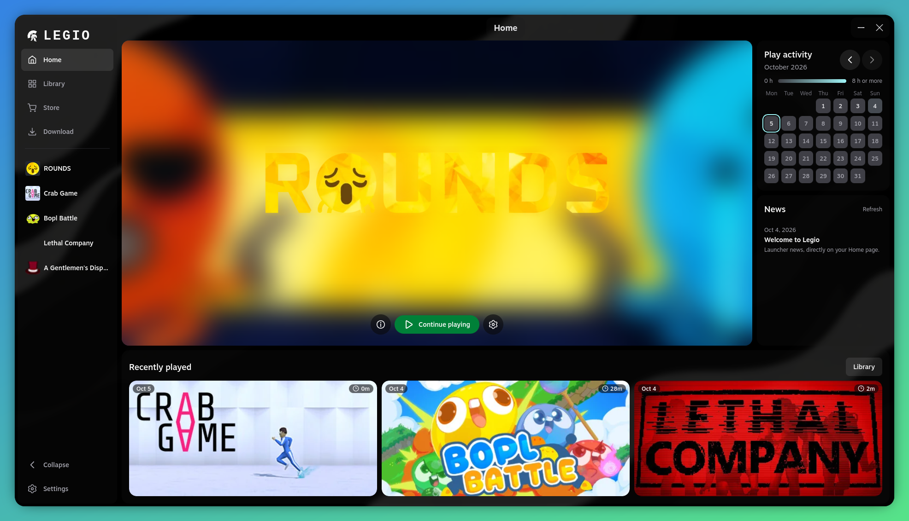

  
  <h1>Legio</h1>
  
Your game library, with launch settings tailored to each title.

  
<a href="https://github.com/fraa2a/Legio/releases">Download Legio</a>

Legio is a desktop game launcher for Windows and Linux. Import games from Steam or add them manually, configure how each game launches, and keep your library and playtime in one place.

## Features

- **A Steam account for each game.** If you use multiple accounts, assign the right one to each title. Legio asks before restarting Steam to switch accounts when needed.
- **Per-game launch settings.** Run native Linux games or Windows games through Proton, GE-Proton, or Wine. Configure prefixes, launch arguments, environment variables, and DLL overrides on Linux, or native launch options on Windows.
- **Flexible game import.** Detect your Steam library or add games and executables manually.
- **Themes you can make your own.** Choose from built-in palettes, edit colors, set image or animated backgrounds, and save your own themes. Import and export themes as JSON.
- **Hyprland transparency.** Enable a transparent Legio window on Hyprland and adjust the surface opacity. Background blur is controlled by your Hyprland rules.
- **Playtime at a glance.** See recently played games, tracked playtime, and a calendar of your activity.

## Online Fix

Legio includes an Online Fix launch option for compatible games. It is a launch configuration feature: Legio does not provide or distribute game files or Online Fix files.

Legio does not support or promote piracy. Use this option only with a legitimately purchased copy of the game and for offline play, in accordance with the game's license and applicable laws. Users are responsible for their use of this feature; Legio accepts no responsibility for misuse.

## Download

### [Download the latest release](https://github.com/fraa2a/Legio/releases/latest)

- **Windows:** `.exe` installer.
- **Linux:** AppImage, `.deb` or `.rpm`.
- **Arch Linux / AUR:** `legio-launcher-bin` for stable binaries, or `legio-launcher-git` to compile the latest `main` sources.

Steam is required for Steam integration. For Windows games on Linux, see [runner setup](_meta/docs/LINUX.md).

## Download sources

Add an HTTPS catalog in **Settings > Sources**. You can install multiple sources,
refresh their cached releases, and remove them individually. No download source
is configured by default.

**Hydra sources are also supported.** Some source URLs are protected by Cloudflare and cannot be fetched directly by Legio. Download the actual JSON file in your browser, then use **Choose JSON file** in Sources to select its local path. Use a JSON file, not a saved challenge page. Local refresh rereads that file; it does not download a newer copy. See [Hydra compatibility](_meta/docs/HYDRA.md) for supported downloads and limitations.

After starting Legio once, opening a link such as
`legio://add-source?url=https%3A%2F%2Fcatalogo.example%2Fgames.json`
opens the launcher and adds the catalog. The browser may ask to open Legio.
AppImage users need `xdg-utils` and `desktop-file-utils` for protocol registration;
keep the AppImage at a stable path, or run it again after moving it.

## Development

Follow [Development setup](_meta/docs/DEVELOPMENT.md) for Linux and Windows
prerequisites, then run `corepack pnpm install --frozen-lockfile` and
`corepack pnpm tauri dev`. Development runs use a separate application profile
and do not modify the installed launcher's data. See [Contributing](CONTRIBUTING.md)
for checks and the pull request workflow.

## Documentation

- [Documentation index](_meta/docs/README.md)
- [Development setup](_meta/docs/DEVELOPMENT.md) and [contributing](CONTRIBUTING.md)
- [Known issues and limitations](_meta/docs/KNOWN-ISSUES.md)
- [Source schemas and download flow](_meta/docs/SCHEMA.md)
- [Releases and updates](_meta/docs/UPDATING.md)

## License

Legio is source-available under SA-NC-PD 1.0, not an open-source license.
The license restricts commercial use and distribution of modified versions,
with a specific exception for proposing contributions. Read [LICENSE](LICENSE)
for the complete terms and [Contributing](CONTRIBUTING.md) before submitting changes.
Third-party material retains its own licenses; see [THIRD_PARTY_NOTICES.md](THIRD_PARTY_NOTICES.md).
